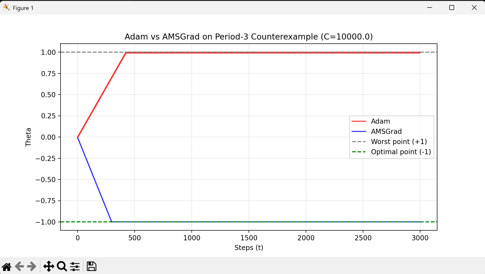
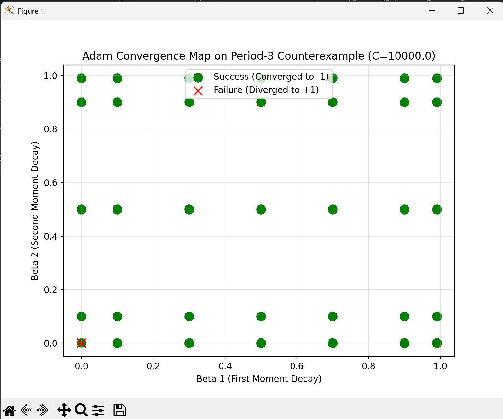
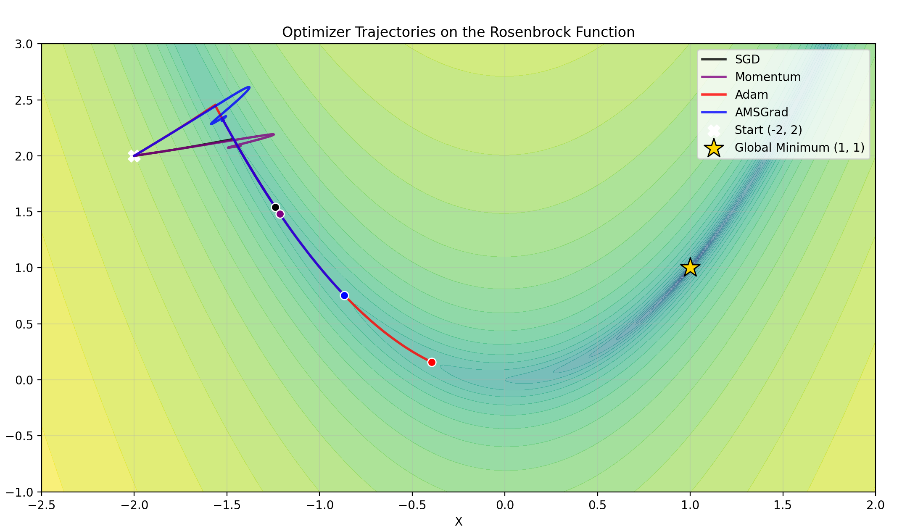

# Deep Learning Optimizers from Scratch: Adam vs. AMSGrad

[](https://www.python.org/downloads/)
[](https://numpy.org/)
[](https://pytorch.org/)

A from-scratch NumPy replication and empirical benchmarking of the foundational adaptive optimization literature:

1. **Kingma & Ba (2014)**: *Adam: A Method for Stochastic Optimization* (ICLR 2015).
2. **Reddi, Kale & Kumar (2018)**: *On the Convergence of Adam and Beyond* (ICLR 2018).

This repository contains:

- Vectorized NumPy implementations of **SGD**, **Momentum**, **Adam**, and **AMSGrad**.
- A reconstruction of the **Period-3 Convergence Trap** from Reddi et al., showing Adam's failure under rare, large gradient spikes.
- A **PyTorch cross-check** against `torch.optim.Adam`, matching to within float32 precision (max difference ≈ `1.2e-7` over 5 steps).
- A **hyperparameter sweep** over (β₁, β₂) mapping where Adam converges or diverges on the counterexample.
- **Rosenbrock** benchmarking to compare adaptive and non-adaptive methods on a non-convex valley.

---

## 📊 Key Findings & Figures

### 1. The Period-3 Convergence Trap

Adam scales its step by the inverse square root of an exponential moving average of squared gradients ($v_t$). When a large gradient appears only once every few steps, that average decays between spikes, so Adam "forgets" the spike and takes oversized steps in the wrong direction. AMSGrad keeps a running maximum of $v_t$, so the effective step size never grows back.

With $C = 10000$, Adam drifts to the worst point (+1) within ~450 steps, while AMSGrad reaches the optimum (-1) within ~300 steps and stays there.

| Adam vs AMSGrad on the Period-3 Counterexample |
| :---: |
|  |
| *Figure 1: Adam (red) converges to the worst point +1; AMSGrad (blue) converges to the optimum -1.* |

### 2. Hyperparameter Sweep (β₁, β₂)

To check how sensitive the failure is, Adam was run across a grid of (β₁, β₂) values on the same counterexample ($C = 10000$).

In this sweep, Adam diverged **only at β₁ = 0, β₂ = 0**; every other grid point converged to -1. The failure is therefore narrow under this setup and depends on the specific hyperparameters and the magnitude of $C$.

| Adam Convergence Map on the Period-3 Counterexample |
| :---: |
|  |
| *Figure 2: Green = converged to -1, red ✕ = diverged to +1. Grid values of 1.0 are plotted at 0.99.* |

### 3. Rosenbrock Benchmark

The four optimizers were run from $(-2, 2)$ on $f(x, y) = (1-x)^2 + 100(y-x^2)^2$, with global minimum at $(1, 1)$.

All four methods enter the curved valley quickly, but **none reaches the minimum within the step budget**. Adam advances furthest along the valley, AMSGrad is in the middle, and SGD and Momentum lag well behind. Momentum shows an early overshoot loop before settling onto the valley path. Adam and AMSGrad also show a short initial overshoot before following the valley floor.

| Optimizer Trajectories on the Rosenbrock Function |
| :---: |
|  |
| *Figure 3: End-of-run positions (dots) show Adam furthest along the valley; no method has reached the star at (1, 1).* |

---

## ✅ Validation Results

| Check | Result |
| :--- | :--- |
| Custom Adam vs `torch.optim.Adam` (5 steps) | Max difference ≈ `1.2e-7` (float32 rounding) |
| Adam manual verification | Step 1: θ = -0.010000, Step 2: θ = -0.015926 |
| AMSGrad manual verification | Step 1: θ = -0.031623, Step 2: θ = -0.056808 |
| SGD on quadratic bowl | θ → `1.4e-4` by step 50 |
| Momentum on quadratic bowl | Oscillates (overshoots) before settling: θ = 0.74 at step 50 |

---

## 🛠️ Repository Map

```text
.
├── optimizers.py                 # Vectorized core optimizer classes (SGD, Momentum, Adam, AMSGrad)
├── validation.py                 # Cross-examination against torch.optim.Adam
├── counterexample.py             # Reproduces the Period-3 trap from Reddi et al.
├── rosenbrock.py                 # 2D non-convex contour optimization benchmark
├── sweep.py                      # Hyperparameter boundary mapping
├── experiments/                  # Step-by-step manual validation scripts
│   ├── adam_verification.py      # Manual step-by-step state verification
│   └── toy_test.py               # Basic quadratic bowl validation
├── figures/                      # Result plots used in this README
├── 2015 adams research paper.pdf # Reference literature
├── 2018 counterexample research paper.pdf # Reference literature
└── README.md                     # Project documentation
```

---

## ⚡ Quick Start & Reproduction

### 1. Environment Setup

```bash
git clone https://github.com/BinaryGenius06/adam-amsgrad-research.git
cd adam-amsgrad-research
pip install numpy matplotlib torch
```

### 2. Run PyTorch Validation

Verify that the custom NumPy Adam matches PyTorch.

```bash
python validation.py
```

### 3. Generate Plots & Benchmarks

```bash
python counterexample.py   # Figure 1
python sweep.py            # Figure 2
python rosenbrock.py       # Figure 3
```

---

## 👨‍💻 Author

**Suryansh U.**

Undergraduate Researcher | Sophomore at IIT Delhi

---

## 📚 References

- Kingma, D. P., & Ba, J. (2014). *Adam: A Method for Stochastic Optimization*. arXiv preprint arXiv:1412.6980.
- Reddi, S. J., Kale, S., & Kumar, S. (2018). *On the Convergence of Adam and Beyond*. International Conference on Learning Representations (ICLR).
